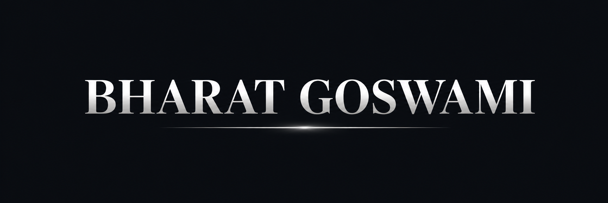

 

  
  
  
    

 

## 👨‍💻 About Me

I am a B.Tech Computer Science Engineering student specializing in Artificial Intelligence and Machine Learning. I enjoy building intelligent applications using Python and exploring technologies related to AI, Backend Development, Data Analytics, and Software Engineering.

My current learning journey focuses on **Deep Learning, AI Agents, MCP Servers, FastAPI, PostgreSQL,** and **Data Structures & Algorithms**. I believe in learning by building real-world projects and continuously improving my problem-solving skills.

 

  <picture>
    <source media="(prefers-color-scheme: dark)" srcset="https://raw.githubusercontent.com/bharat19334/bharat19334/output/github-contribution-grid-snake-dark.svg" />
    <source media="(prefers-color-scheme: light)" srcset="https://raw.githubusercontent.com/bharat19334/bharat19334/output/github-contribution-grid-snake.svg" />
    
  </picture>

---

## 📈 GitHub Statistics

  
  
  

---

### 🛠️ Tech Stack & Tools

  

  
  
  
  
  
  

---

## 🚀 Projects

**💻 DSA & Algorithm Projects**

| Project | Description | Tech Stack |
|---|---|---|
| **[DeepAlgoMinds](https://github.com/bharat19334/DeepAlgoMinds)** | Algorithm-focused for learning and implementing Data Structures and Algorithms. | `Python` `DSA` `Algorithms` |
| **[DSA Tutor](https://github.com/bharat19334/dsa-tutor)** | AI-powered DSA learning project designed to help users understand and practice Data Structures and Algorithms. | `Python` `AI` `DSA` |
| **[Python DSA](https://github.com/bharat19334/Python-DSA)** | Pattern-wise Data Structures and Algorithms solutions with explanations. | `Python` `DSA` |

**🧠 NLP / AI Projects**

| Project | Description | Tech Stack |
|---|---|---|
| **[Named Entity Recognition with spaCy](https://github.com/bharat19334/Named-entity-recognition-spacy)** | NLP project that identifies and classifies entities such as PERSON, ORG, GPE, DATE, MONEY, PRODUCT, and LOC from text and news articles. | `Python` `spaCy` `NLP` `BeautifulSoup` `Requests` |
| **[Hugging Face Fine-Tune Model](https://github.com/bharat19334/Hugging-Face-FineTune-Model)** | Fine-tuning a pre-trained Hugging Face model for a custom task. | `Python` `Hugging Face` `Transformers` `Fine-Tuning` |
| **[RAG PDF + Pinecone + GPT-2](https://github.com/bharat19334/rag-pdf-pinecone-gpt2)** | Retrieval-Augmented Generation system that retrieves information from PDF documents and generates answers using an LLM. | `Python` `RAG` `Pinecone` `GPT-2` |

**⚡ Backend / API Development**

| Project | Description | Tech Stack |
|---|---|---|
| **[FastAPI URL Shortener API](https://github.com/bharat19334/FastAPI_URL_Shortener_API)** | REST API for creating and managing shortened URLs using FastAPI. | `Python` `FastAPI` `REST API` |
| **[LeetCode Tracker Automation](https://github.com/bharat19334/leetcode-tracker-automation)** | Automation system that tracks LeetCode progress and supports spaced revision of solved problems. | `n8n` `GraphQL API` `JavaScript` `Google Sheets API` |

**🩺 Healthcare AI**

| Project | Description | Tech Stack |
|---|---|---|
| **[COPD_CARE_AI](https://github.com/bharat19334/COPD_CARE_AI)** | AI-driven care assistant for COPD patients. | `Python` `AI/ML` |
| **[COPD Health ChatBot](https://github.com/bharat19334/COPD_Healt_ChatBot)** | AI chatbot for COPD-related health information. | `Python` `FastAPI` `Streamlit` `Scikit-learn` |

**🎓 EdTech / AI Applications**

| Project | Description | Tech Stack |
|---|---|---|
| **[AI Viva Quiz Platform](https://github.com/bharat19334/Ai-Viva-Quiz-platform)** | AI platform for viva-style quizzes. | `Python` `AI/ML` |

**📊 Data Analytics**

| Project | Description | Tech Stack |
|---|---|---|
| **[Web Scraping Project](https://github.com/bharat19334/Data-Science-Projects/tree/main/Web%20Scraping/Books%20to%20Scrape)** | Automated web scraping pipeline. | `Python` `BeautifulSoup` `Requests` |
| **[IPL Match Analysis](https://github.com/bharat19334/Data-Science-Projects/blob/main/IPL%20Match%20Analysis(2008-2026).ipynb)** | EDA on IPL matches and player performance. | `Python` `Pandas` `NumPy` `Matplotlib` |
| **[Railway Delay Analysis](https://github.com/bharat19334/Data-Science-Projects/blob/main/Railway-delay-analysis.ipynb)** | Railway delay pattern analysis. | `Python` `Pandas` `NumPy` `Matplotlib` |

---

## 🏆 Achievements

- 📊 Built Data Analytics Projects
- 💻 Active DSA Learner
- 🚀 Building AI & Backend Projects

---

## 🚀 What I'm Working On

- 🤖 Building AI & Machine Learning Projects
- 📊 Performing Data Analytics on Real-World Datasets
- 🌐 Developing Web Scraping Applications
- 💻 Practicing Data Structures & Algorithms
- ⚡ Learning FastAPI and Backend Development
- 🗄️ Working with PostgreSQL Databases

---

## 📫 Connect With Me

  
  
  &nbsp;&nbsp;
  📍 India

---

### 💡 "Consistency Builds Excellence."
🚀 Building intelligent systems through continuous learning and practical implementation.

